# ESG Open Research — инструкция пользователя

Платформа НИЦ ИИ (Университет «Дубна») совместно с Лабораторией технологий ИНС для управления
бизнесом в формате ESG — для работы над методологией ESG-анализа по циклу

**статьи банка → идея → проверка → отчёт → изменение методики → новая версия методики.**

Каждый шаг видят все участники; отрицательный результат («идея не подтвердилась») — такой же полноценный
итог, как положительный. Часть рутины делает модель ИИ-помощник: предлагает идеи, проверки, пишет
отчёты и черновики предложение. Всё, что пишет ИИ-помощник, — черновик: решают люди.

---

## 1. Вход

1. Адрес платформы: **https://51.250.71.182.sslip.io** — открывается в любом браузере, из любой
   сети. Сертификат сайта настоящий (Let's Encrypt), ничего устанавливать не нужно.
2. Логин и временный пароль выдаёт администратор. При первом входе платформа попросит задать свой пароль.
   Сменить пароль позже — кнопка «Смена пароля» в шапке.

Как устроено: сайт, пользователи и база платформы работают на сервере круглосуточно, а вычисления —
поиск по банке статей, разбор статей, расчёты проверок, модель ИИ-помощник — на компьютере лаборатории
с видеокартой. Если он выключен, сайт открывается, идеи, проверки, отчёты и методика
доступны, а банк статей, загрузка статей, расчёты и ИИ-помощник ждут, пока компьютер включат.

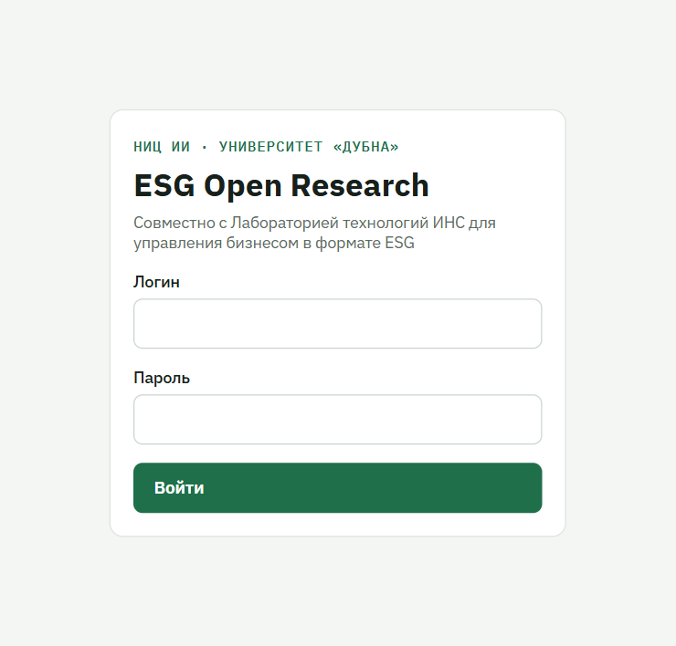

### Роли

| Роль | Что может |
|---|---|
| **читатель** | читать всё, кроме файлов наборов данных под NDA; скачивать отчёты |
| **исследователь** | всё, что reader, плюс: загружать статьи и наборы данных, предлагать идеи, вести проверки, запускать расчёты, править отчёты и тексты предложение, предлагать предложение |
| **рецензент** | всё, что reader, плюс: рецензировать — принимать и отклонять идеи, одобрять отчёты, рецензировать проверки и предложения |
| **администратор** | всё перечисленное, плюс: принимать предложения (новая версия методики), пользователи, журнал действий, задачи ИИ-помощника |

---

## 2. Разделы

| Раздел меню | Зачем |
|---|---|
| **Обзор** | что такое ESG, что уже выяснили, с чего начать |
| **Методика** | что изучает лаборатория и по каким правилам; предложения изменений, история версий, выгрузка в Word |
| **Банк статей** | вкладки «Статьи» (поиск, карточка статьи), «Карта связей» (понятия и связи между ними с цитатами), «Добавить статью» (PDF или DOI) |
| **Идеи для проверки** | идеи лаборатории и ИИ-помощника, их статусы и источники |
| **Проверки** | вкладки «Все проверки» (карточка: постановка, результаты, вывод, рецензии, отчёт), «Новая проверка» (мастер расчёта), «Расчёты» (живой лог, список расчётов) |
| **Данные** | вкладки «Наборы данных» и «Данные из статей» |
| **Задачи Qwen** *(администратор)* | очередь работы модели, её состояние |
| **Пользователи** *(администратор)* | учётные записи, роли, блокировка, журнал действий |

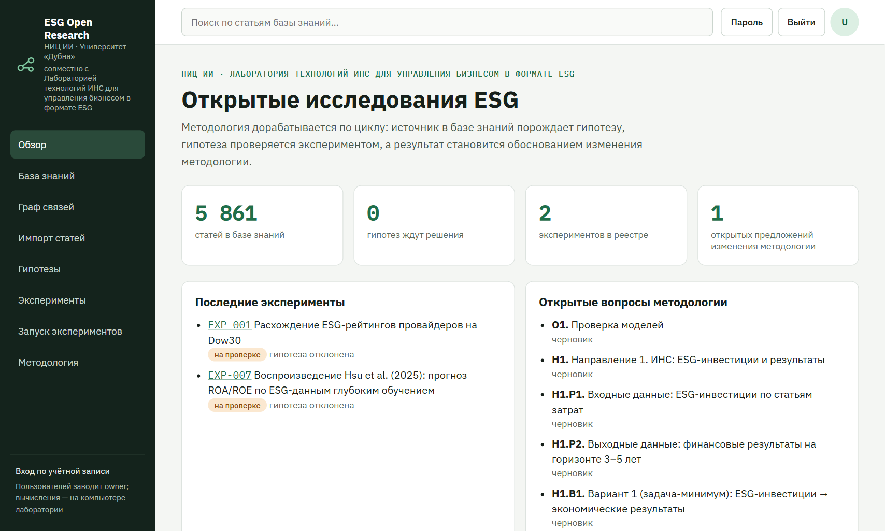

---

## 3. Полный цикл на примере

Ниже — путь одной идеи от статьи до изменения методики. Каждый шаг подробно — в разделе 4.

1. **Статья.** Исследователь загружает статью в «Добавить статью». Платформа разбирает её и добавляет в банк статей; ИИ-помощник достраивает карту связей и ищет идеи для заданий методики.
2. **Идея.** Идею предлагает человек («Предложить идею») или ИИ-помощник (отметка «предложила
   Qwen», с источниками — цитатами из статей). Рецензент нажимает «Принять к проверке» или отклоняет.
3. **Проверка.** На принятую идею ИИ-помощник предлагает проверка: метод из библиотеки, версия данных
   данных, параметры, критерий «что подтвердит или опровергнет». Исследователь правит и одобряет —
   создаются проверка и расчёт. Можно и вручную: «Задам сам» в мастере на вкладке «Новая проверка».
4. **Расчёт.** Расчёт идёт на сервере; лог и метрики видны вживую. Расчёт фиксирует коммит кода,
   хеш данных, окружение и seed — без этого он не попадает в список расчётов.
5. **Отчёт.** После удачного расчёта ИИ-помощник пишет отчёт: цифры и графики — из расчёта, текст —
   модели. Исследователь правит и отправляет на рецензию, рецензент одобряет — отчёт в PDF уходит в
   банк статей (тема «Отчёты проверок»).
6. **предложение.** Если в одобренном отчёте есть «Предложение для методики», ИИ-помощник готовит черновик изменения
   методики с основанием — проверкой. Исследователь правит текст, рецензент одобряет,
   администратор принимает — появляется новая версия методики.

---

## 4. Разделы подробно

### 4.1. Банк статей и карта связей

- **Поиск.** Введите короткий запрос: «ESG и ROA», «расхождение ESG-рейтингов», «SHAP». Длинные
  запросы и обрезанные на полуслове ищутся хуже и дольше.

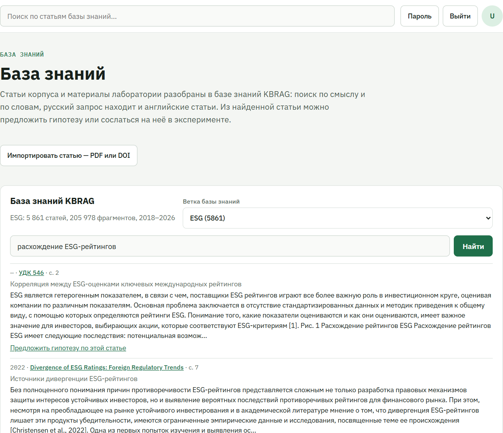
- **Карточка статьи** — метаданные, DOI, текст по фрагментам. «Предложить идею по этой статье»
  открывает форму идеи со ссылкой на статью. Блок «Связать с проверкой или изменением
  методики»: привязать статью к проверке («опирается на статью», «проверяет утверждение
  статьи», «воспроизводит статью», «использует метод статьи») или добавить её основанием к
  открытому предложение («Добавить основание»).

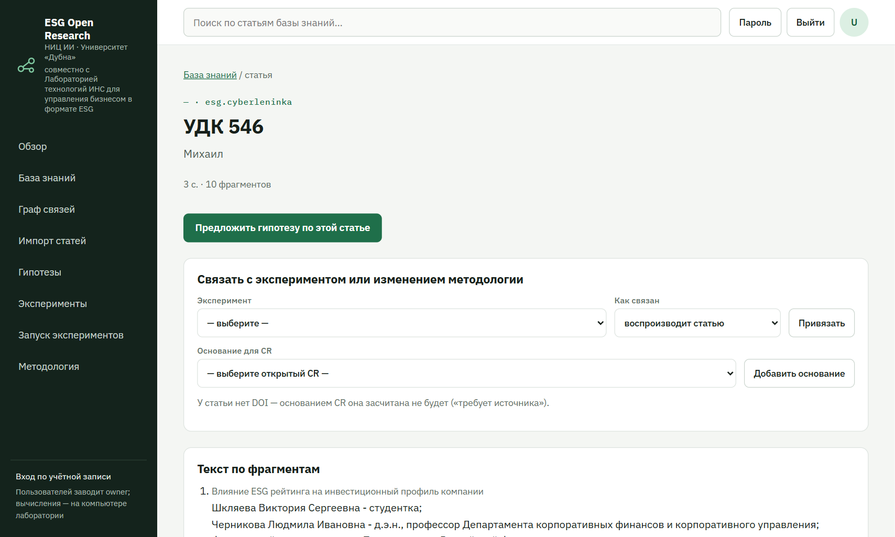
- Статья **без DOI** помечается «требует источника» и **не может быть основанием изменения методики**. Если DOI у
  статьи есть, но не указан, — добавьте его при добавлении.
- **Карта связей** — граф: круги — понятия, стрелки — связи между ними, цвет показывает, повышает, снижает или не влияет. Нажмите на круг: понятие встанет в центр, слева будет то, что на него влияет, справа — на что влияет оно. Нажатие на стрелку или число статей в панели открывает цитаты. Понятия (компании, показатели, методы) и факты между ними. Каждый факт — с
  цитатой из статьи. Карта редактируется только в банке статей, на платформе его можно смотреть и искать.

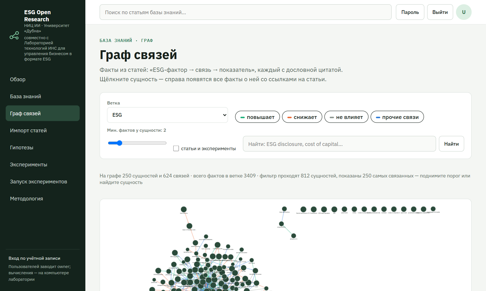

### 4.2. Добавить статью *(исследователь)*

1. Выберите **тему банка статей** (тема корпуса).
2. **PDF-файлом**: файл, DOI, название, год, авторы → «Загрузить». **По DOI**: только DOI →
   «Найти и загрузить» (платформа сама скачает открытый PDF, если он есть).
3. В таблице «Загруженные статьи» видно статус: в очереди → загружается → в банке статей (или «уже
   был в банке статей», «не удался»). Разбор занимает от минуты до нескольких минут.
4. После добавления ИИ-помощник сам достроит карту связей и поищет новые идеи — они появятся в «Гипотезах».

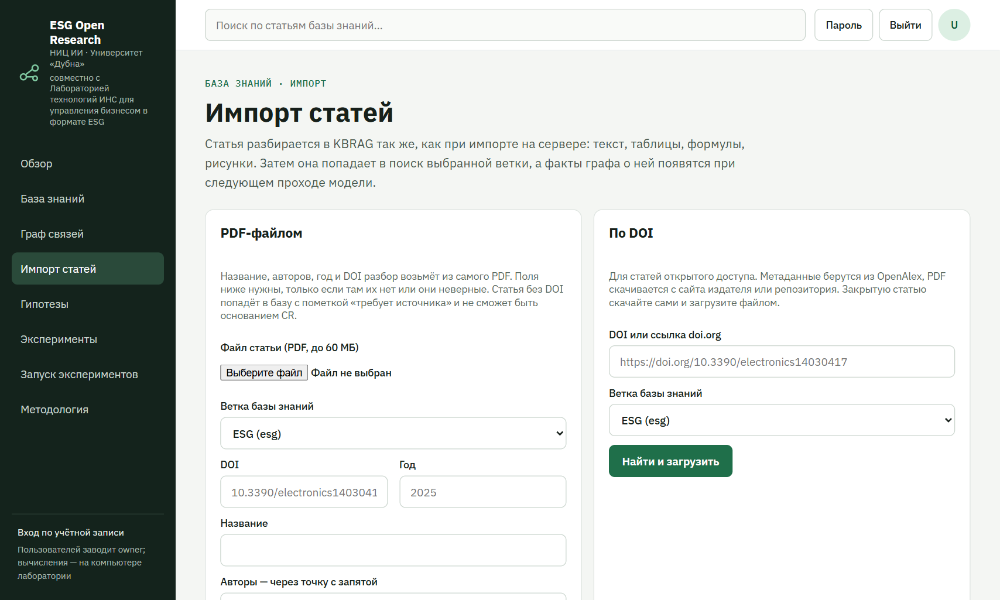

### 4.3. Наборы данных

- Список наборов данных — в разделе «Данные» (кнопка «Новый набор данных» — researcher). У каждого
  набора данных своя страница (`DS-01`, `DS-05` …): описание, источник, лицензия, доступ (открытый /
  под NDA), **версии данных** и проверки на них.

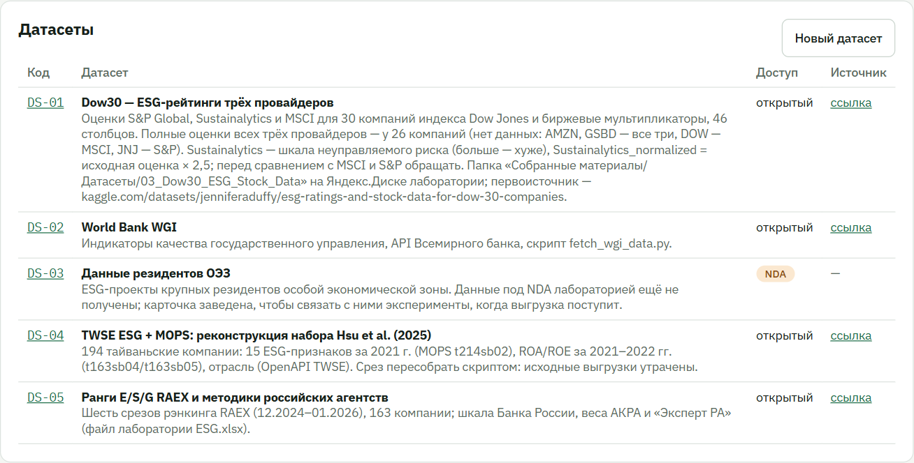
- **Версия данных** — зафиксированная версия файла данных с хешем sha256; расчёт всегда идёт на конкретном
  версии данных. Новая версия данных: «Загрузить версию данных» (небольшой файл) или «…или зарегистрировать файл с сервера»
  (большой файл, который уже лежит в каталоге набора данных на сервере).

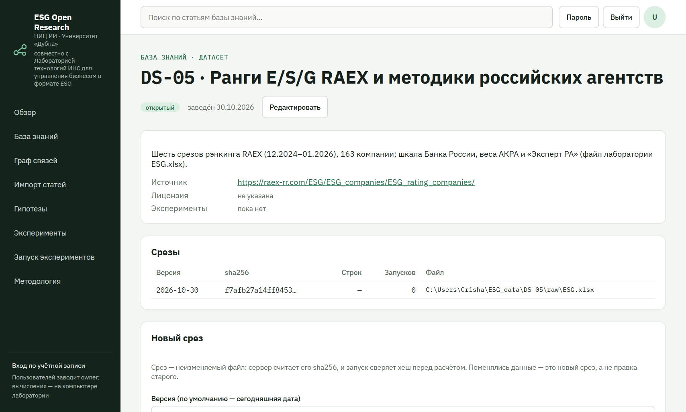
- **Данные из статей.** После добавления статьи обработчик ищет в ней таблицы с исходными данными, а ИИ-помощник отбирает
  подходящие и описывает их — получаются черновики. Таблицу можно поправить руками или командой словами, все
  правки записываются. «Создать набор данных» даёт новый `DS-NN` со ссылкой на статью и записью обработки; условия
  использования таких данных определяет сама статья. Поиск по всем статьям запускает администратор: он может занять часы.
- Файлы под **NDA** видят только допущенные; описание набора данных видно всем.
- Общие методы читают **CSV** и **книги Excel (.xlsx)**. У книги лист-таблица — тот, где в первых
  пяти строках есть строка заголовка; столбцы без заголовка (заметки справа) не читаются.
  Буквенные рейтинги (AAA…D, ESG-AA, ESG-BBB+) считаются числами по порядку шкалы; «отозван», «—»,
  «н/д» — пропуск.

### 4.4. Идеи

- **Предложить идею** *(исследователь)*: формулировка («ESG-раскрытие снижает стоимость долга»),
  обоснование («почему так думаете»), задание методики, к которому она относится.
- Фильтры: «Ждут моего действия», «Все», «От Qwen», «Ждут решения», «Приняты», «Проверяются», «Проверены», «Отклонены».
- У идеи от ИИ-помощника — **источники**: цитаты из статей банка статей со ссылками. Проверьте, что цитаты
  действительно говорят то, на что опирается идея.
- **Решение** *(рецензент)*: «Принять к проверке» или отклонить. Принятую идею ИИ-помощник снабдит
  предложением проверки, когда дойдёт её очередь.
- **Проверить идею** *(исследователь)* — кнопка на карточке принятой идеи ведёт в мастер на
  вкладке «Новая проверка» (раздел 4.6).

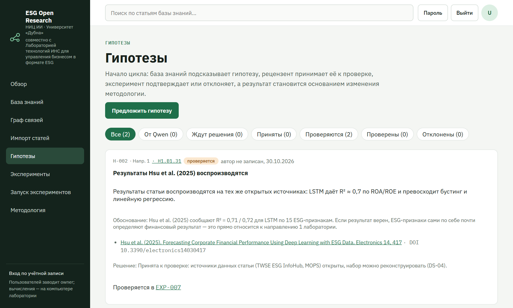

### 4.5. Проверки

- **Реестр проверок** — все проверки со статусом: запланирован, в работе, на проверке,
  завершена — нужна возможность повторить расчёт, и итогом: идея подтвердилась / отклонена.

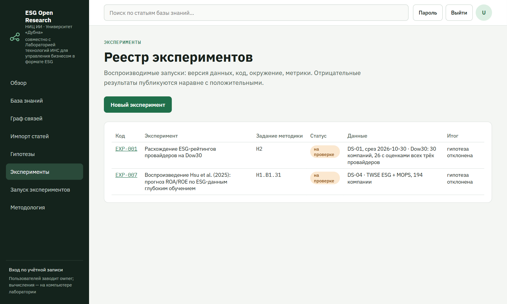
- **Карточка проверки**: идея, задание методики, постановка (данные, метод, шаги),
  результаты (ключевые цифры, графики), интерпретация, вывод, влияние на методику,
  воспроизводимость (коммит runner, окружение, версия данных, seed), расчёты, рецензии, связи с банком статей, **отчёт**.

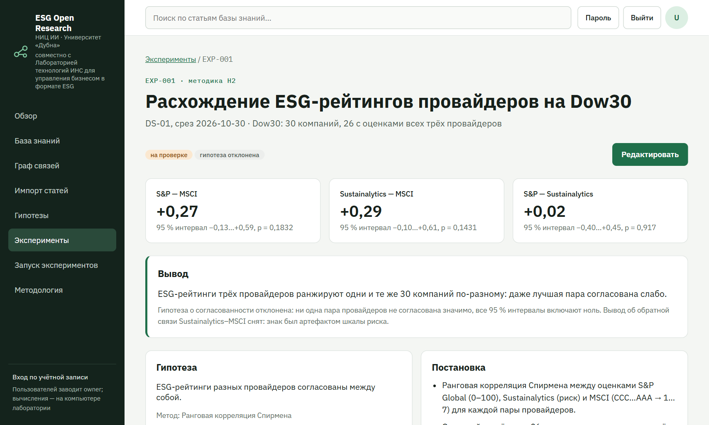
- **Редактировать** *(исследователь)* — разделы, ключевые цифры (до 8), графики: «полосы» (сравнение
  величин, до трёх серий) и «диапазоны» (среднее и разброс). Данные графика вставляются таблицей
  через «;», с предпросмотром.
- **Рецензия** *(рецензент)* — вердикт и комментарий внизу карточки.

### 4.6. Новая проверка *(исследователь)*

1. Вкладка **«Проверить идею»** — мастер для принятой идеи:
   - **«Взять предложение ИИ-помощника»**: метод, версия данных, параметры и критерий подобрала модель. Проверьте и
     **одобрите** — создадутся проверка и расчёт; или **отклоните** с причиной. Если предложение
     содержит ошибку (столбца нет в версии данных и т. п.), мастер покажет её. Повтор опубликованного расчёта
     нужно подтвердить отдельно: новых показателей он не считает. Если предложения нет, мастер
     скажет почему, и модель можно попросить ещё раз.
   - **«Задам сам»**: метод, версия данных, параметры и обязательный критерий «что подтвердит или опровергнет»,
     записанный до расчёта. Если сервер не принял расчёт, проверка не создаётся — поправьте и
     повторите. Нет подходящего метода или данных — «Создать только карточку, без расчёта».

   Внизу вкладки — **«Пересчитать уже созданную проверку»**: метод, проверка, версия данных,
   параметры.
2. Методы библиотеки:
   - **Согласованность показателей** (`rank-agreement`) — ρ Спирмена для каждой пары выбранных
     столбцов, 95 % бутстреп-интервал, перестановочный тест. Для сравнения рейтингов провайдеров,
     оценок. Столбцы «больше — хуже» (шкала риска) отметьте — знак обратится.
   - **Предсказательная проверка** (`predictive-check`, протокол CR-01) — предсказывают ли признаки
     целевой показатель лучше среднего: 30 случайных разбиений, плацебо на перемешанной цели, R² на
     отложенной выборке.
   - **Повторы** опубликованных расчётов (EXP-001, EXP-007) — только на своём наборе данных.
3. У версии данных Excel сначала выберите **лист книги** — появятся его столбцы. Для параметров-столбцов
   показываются только подходящие (для чисел — числовые).

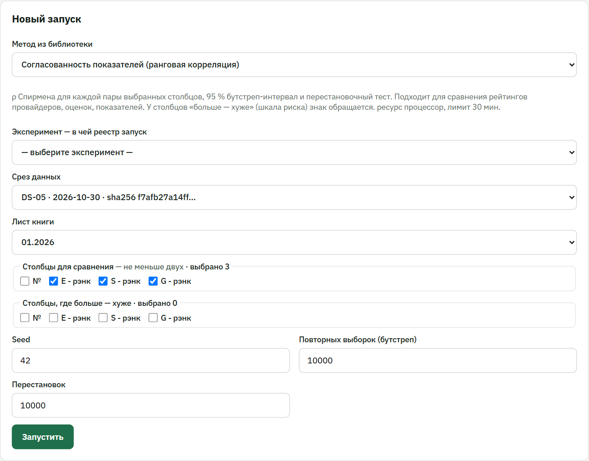
4. «Запустить» → страница расчёта: живой **лог** и **метрики**, затем итог и «Параметры и
   воспроизводимость». Расчёт дольше лимита метода останавливается.

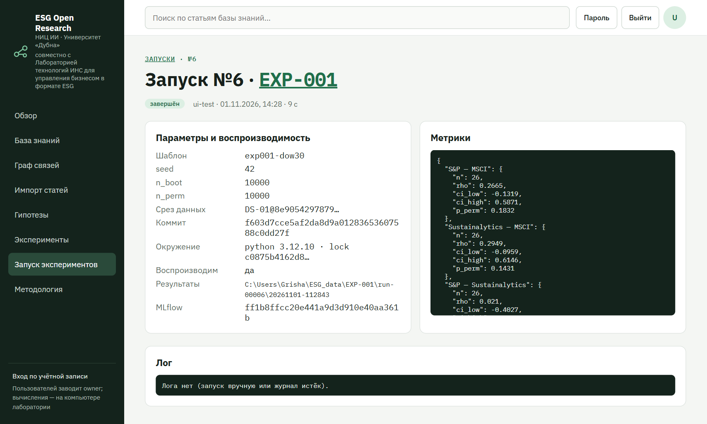
5. Вкладка **«Все расчёты»** — все расчёты с отметкой «воспроизводим» (есть коммит без несохранённых
   правок, версия данных, окружение, seed).

### 4.7. Отчёт об проверке

Блок «Отчёт» на карточке проверки.

1. Отчёт появляется сам после удачного расчёта. Для уже посчитанного проверки — «Сформировать
   отчёт», для новой редакции — «Новая версия отчёта». ИИ-помощник пишет текст несколько минут.
2. В отчёте: резюме, вердикт по идее, интерпретация, значение для задания методики, предложение
   для методики, ограничения, что дальше. **Цифры, таблицы и графики берутся из расчёта** — модель
   их не придумывает; числа в тексте сверяются с расчётом, лишние показаны предупреждением.
3. **Прочитайте текст**: модель может переоценить вывод, сослаться на статью шире, чем та говорит,
   или записать в «Предложение для методики» план следующего проверки. Исправьте —
   «Править текст».
4. «На рецензию» *(исследователь)* → рецензент «Одобрить и отправить в банк статей» или «Отклонить»
   с причиной *(рецензент)*.
5. «Скачать Word» / «Скачать PDF» — в любой момент.
6. Одобренный отчёт попадает в банк статей (тема «Отчёты проверок»); статус загрузки виден
   на карточке. Если в отчёте есть предложение для методики — ИИ-помощник готовит черновик предложение (ссылка
   появится в блоке отчёта); для любого одобренного отчёта можно нажать «Предложить изменение методики по отчёту».

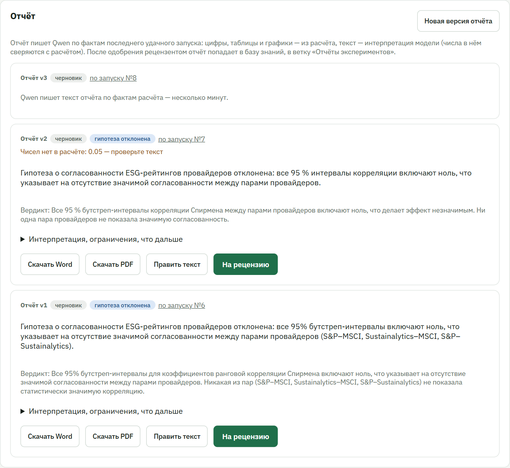

### 4.8. Методика и предложение

- **Дерево методики**: направление → вариант → задание; **разделы** (правила) висят на любом узле
  и действуют на всё, что ниже; «Общие разделы» — на всю методику. У пункта видны идеи,
  проверки и открытые предложение, которые к нему относятся.

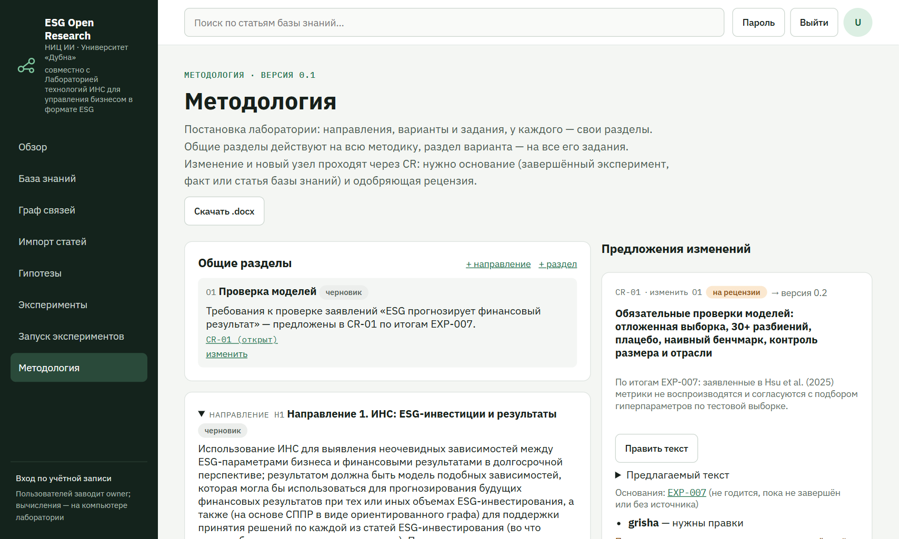
- **Предложить изменение** *(исследователь)*: у пункта «Изменить» (новый текст пункта) или «Добавить»
  (новый вариант, задание или раздел под ним). Поля: что меняется, зачем (что показали проверки
  или статьи), основание — проверка (можно добавить позже).
- **Принять предложение можно только при двух условиях** (проверяет сервер):
  1. есть хотя бы одно годное **основание** — завершённая проверка, проверенный факт банка статей
     с цитатой или статья с DOI;
  2. есть хотя бы одна **одобряющая рецензия**.
  Пока условия не выполнены, на карточке предложение написано, чего не хватает.

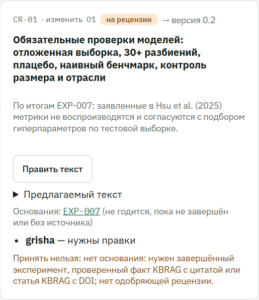
- **Рецензия предложение** *(рецензент)*: «Одобрить», «Нужны правки», «Отклонить» с комментарием.
- **Черновик ИИ-помощника** отмечен «черновик ИИ-помощника по отчёту EXP-… vN» и строкой «Проверить: …» (числа не
  из расчёта, незавершённая проверка). Текст предложения можно править, **пока нет одобряющей рецензии** —
  одобряют конкретный текст.
- **Принять** *(администратор)* — изменение вносится в методику, создаётся новая версия.
- **История версий** — все версии с пояснением, сравнение двух версий по разделам; выгрузка
  текущей методики в Word.

---

## 5. Что делает ИИ-помощник и чего от неё ждать

Модель Qwen3-14B работает на компьютере лаборатории с видеокартой **по требованию**: когда появляется работа,
она запускается (около минуты), выполняет задачи по очереди и выключается после 10 минут простоя.
Поэтому результат приходит не мгновенно — обычно через 1–10 минут; страница обновится сама.

| Когда | Что делает ИИ-помощник | Где смотреть |
|---|---|---|
| новая статья | достраивает карту связей, ищет идеи для заданий методики | «Карта связей», «Идеи» → «От Qwen» |
| новая версия данных | ищет идеи, которые можно проверить на этих данных | «Идеи» |
| идею приняли | предлагает проверка | карточка идеи |
| удачный расчёт | пишет текст отчёта | карточка проверки → «Отчёт» |
| отчёт одобрен | предлагает предложение | «Методика» → «Предложения изменений» |

Ограничения модели: она может ошибаться в формулировках, переоценивать слабый результат, повторять
ограничения вместо выводов. Цифры в отчётах всегда из расчёта, но **текст — проверяйте**. В базе
знаний около 5 900 статей; карта связей по статьям, загруженным последними, строится отдельным долгим
прогоном, и до его окончания ИИ-помощник опирается на них только через поиск по тексту.

---

## 6. Для администратора

- **Пользователи** → «Новый пользователь»: логин, имя, роль. Платформа покажет **временный пароль
  один раз** — передайте его человеку; при первом входе он задаст свой. «Заблокировать» /
  «Разблокировать» — доступ без удаления истории.
- **Журнал действий** (на странице «Пользователи») — кто, что и когда изменил; содержимое запросов
  (пароли) не пишется.
- **Задачи Qwen** — состояние модели и видеокарты, очередь, история задач; можно поставить задачу
  вручную (проверка модели, достроить карту связей, поиск идей) или снять задачу из очереди.
- **Принятие предложений** и новые версии методики — только администратор.

---

## 7. Правила, которые соблюдает платформа

1. У каждой записи неизменяемый код: `DS-01` — набор данных, `EXP-001` — проверка, `H-001` —
   идея, `CR-01` — изменение методики.
2. Методика меняется **только через предложение** с основанием и одобряющей рецензией.
3. Каждый расчёт фиксирует коммит кода, хеш версии данных, окружение и seed.
4. Отрицательные результаты публикуются наравне с положительными.
5. Статья без DOI и источника — «требует источника», основанием изменения методики не служит.
6. Данные под NDA: описание видно всем, файлы — только допущенным.

---

## 8. Если что-то не так

| Проблема | Что сделать |
|---|---|
| сайт не открывается | проверьте адрес: https://51.250.71.182.sslip.io; если не помогает — сообщите администратору |
| сайт работает, а банк статей, расчёты и ИИ-помощник — нет | выключен компьютер с вычислениями — задачи дождутся его включения |
| «Ошибка 403» / нет кнопки | у вашей роли нет этого действия — обратитесь к администратору |
| поиск по банке статей долго молчит | сократите запрос до 2–4 слов |
| расчёт: «в версии данных нет столбцов …» | выбран другой лист книги или версия данных — проверьте лист и столбцы |
| предложение не принимается | на карточке предложение написано, чего не хватает: основания или одобряющей рецензии |
| ИИ-помощник долго не отвечает | модель запускается по требованию — подождите до 10 минут; если дольше, сообщите администратору (раздел «Задачи Qwen») |
| ошибка в тексте ИИ-помощник | правьте: «Править текст» в отчёте или предложение, отклоняйте предложения с причиной |
