# ESG Open Research — инструкция пользователя

Платформа лаборатории НИЦ ИИ (Университет «Дубна») для работы над методологией ESG-анализа по циклу

**статьи базы знаний → гипотеза → эксперимент → отчёт → изменение методологии (CR) → новая версия методологии.**

Каждый шаг видят все участники; отрицательный результат («гипотеза отклонена») — такой же полноценный
итог, как положительный. Часть рутины делает модель Qwen: предлагает гипотезы, эксперименты, пишет
отчёты и черновики CR. Всё, что пишет Qwen, — черновик: решают люди.

---

## 1. Вход

1. Платформа доступна только из внутренней сети лаборатории: **https://10.203.1.57:8080**.
2. Один раз установите корневой сертификат лаборатории — иначе браузер покажет предупреждение.
   Файл `lab-root-ca.crt` выдаёт администратор (owner). В Windows: двойной щелчок по файлу →
   «Установить сертификат» → «Локальный компьютер» → «Поместить все сертификаты в хранилище» →
   «Доверенные корневые центры сертификации». Перезапустите браузер.
   Предупреждение о сертификате не «пропускайте» — установите сертификат.
3. Логин и временный пароль выдаёт owner. При первом входе платформа попросит задать свой пароль.
   Сменить пароль позже — кнопка «Смена пароля» в шапке.

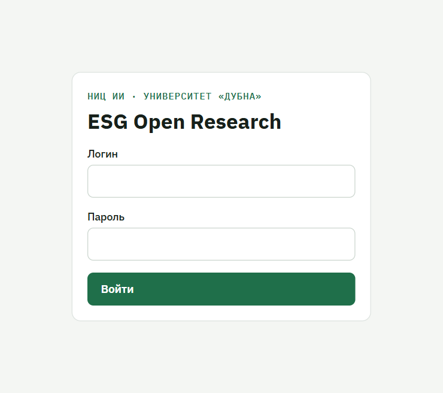

### Роли

| Роль | Что может |
|---|---|
| **reader** | читать всё, кроме файлов датасетов под NDA; скачивать отчёты |
| **researcher** | всё, что reader, плюс: загружать статьи и датасеты, предлагать гипотезы, вести эксперименты, запускать расчёты, править отчёты и тексты CR, предлагать CR |
| **reviewer** | всё, что reader, плюс: рецензировать — принимать и отклонять гипотезы, одобрять отчёты, рецензировать эксперименты и CR |
| **owner** | всё перечисленное, плюс: принимать CR (новая версия методологии), пользователи, журнал действий, задачи Qwen |

---

## 2. Разделы

| Раздел меню | Зачем |
|---|---|
| **Обзор** | сводка: статьи, гипотезы, эксперименты, открытые CR; последние эксперименты, открытые вопросы методологии, материалы лаборатории |
| **База знаний** | поиск по статьям корпуса (KBRAG), карточка статьи, **список датасетов**, состав корпуса |
| **Граф связей** | факты из статей: сущности и связи между ними с цитатами |
| **Импорт статей** | загрузка статей в базу знаний — PDF-файлом или по DOI |
| **Гипотезы** | гипотезы лаборатории и от Qwen, их статусы, предложения экспериментов |
| **Эксперименты** | реестр экспериментов и карточка каждого: постановка, результаты, вывод, рецензии, отчёт |
| **Запуск экспериментов** | форма запуска расчёта, живой лог, реестр запусков |
| **Методология** | дерево методики, предложения изменений (CR), история версий, выгрузка в Word |
| **Задачи Qwen** *(owner)* | очередь работы модели, её состояние |
| **Пользователи** *(owner)* | учётные записи, роли, блокировка, журнал действий |

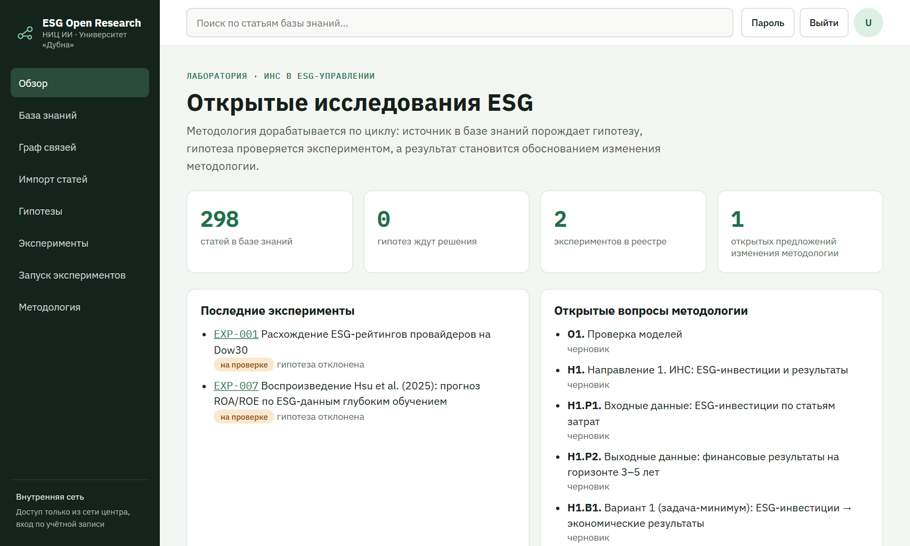

---

## 3. Полный цикл на примере

Ниже — путь одной идеи от статьи до изменения методологии. Каждый шаг подробно — в разделе 4.

1. **Статья.** Исследователь загружает статью в «Импорт статей». Платформа разбирает её в базу
   знаний; Qwen достраивает граф фактов и ищет гипотезы для заданий методики.
2. **Гипотеза.** Гипотезу предлагает человек («Предложить гипотезу») или Qwen (отметка «предложила
   Qwen», с опорами — цитатами из статей). Рецензент нажимает «Принять к проверке» или отклоняет.
3. **Эксперимент.** На принятую гипотезу Qwen предлагает эксперимент: метод из библиотеки, срез
   данных, параметры, критерий «что подтвердит или опровергнет». Исследователь правит и одобряет —
   создаются эксперимент и запуск. Можно и вручную: «Новый эксперимент» и «Запуск экспериментов».
4. **Запуск.** Расчёт идёт на сервере; лог и метрики видны вживую. Запуск фиксирует коммит кода,
   хеш среза данных, окружение и seed — без этого он не попадает в реестр.
5. **Отчёт.** После удачного запуска Qwen пишет отчёт: цифры и графики — из расчёта, текст —
   модели. Исследователь правит и отправляет на рецензию, рецензент одобряет — отчёт в PDF уходит в
   базу знаний (ветка «Отчёты экспериментов»).
6. **CR.** Если в одобренном отчёте есть «Предложение для методики», Qwen готовит черновик изменения
   методологии (CR) с основанием — экспериментом. Исследователь правит текст, рецензент одобряет,
   owner принимает — появляется новая версия методологии.

---

## 4. Разделы подробно

### 4.1. База знаний и граф

- **Поиск.** Введите короткий запрос: «ESG и ROA», «расхождение ESG-рейтингов», «SHAP». Длинные
  запросы и обрезанные на полуслове ищутся хуже и дольше.

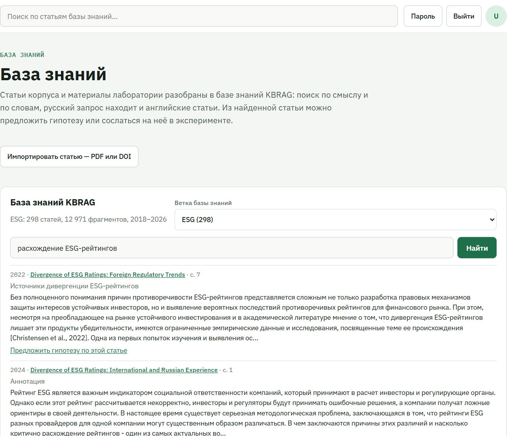
- **Карточка статьи** — метаданные, DOI, текст по фрагментам. «Предложить гипотезу по этой статье»
  открывает форму гипотезы со ссылкой на статью. Блок «Связать с экспериментом или изменением
  методологии»: привязать статью к эксперименту («опирается на статью», «проверяет утверждение
  статьи», «воспроизводит статью», «использует метод статьи») или добавить её основанием к
  открытому CR («Добавить основание»).

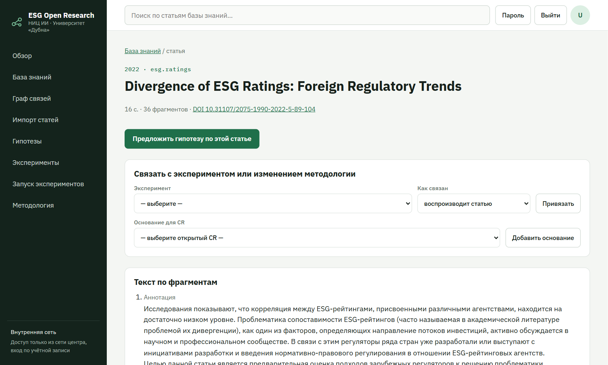
- Статья **без DOI** помечается «требует источника» и **не может быть основанием CR**. Если DOI у
  статьи есть, но не указан, — добавьте его при импорте.
- **Граф связей** — сущности (компании, показатели, методы) и факты между ними. Каждый факт — с
  цитатой из статьи. Граф редактируется только в KBRAG, на платформе его можно смотреть и искать.

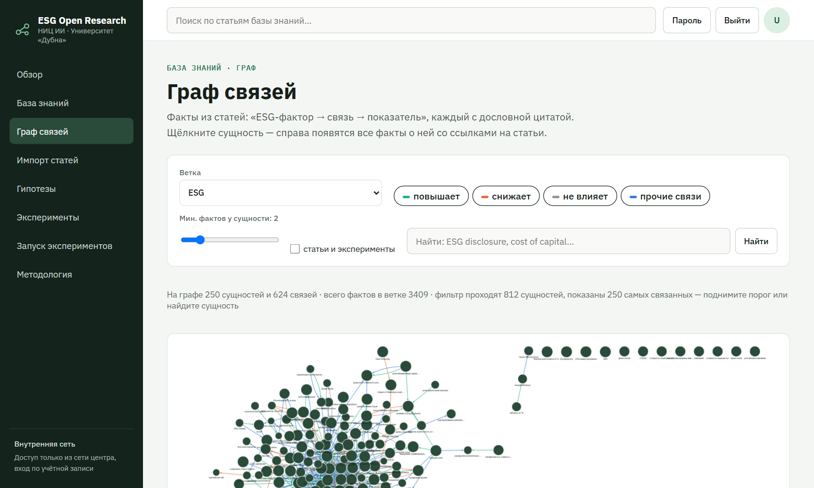

### 4.2. Импорт статей *(researcher)*

1. Выберите **ветку базы знаний** (тема корпуса).
2. **PDF-файлом**: файл, DOI, название, год, авторы → «Загрузить». **По DOI**: только DOI →
   «Найти и загрузить» (платформа сама скачает открытый PDF, если он есть).
3. В таблице «Загруженные статьи» видно статус: в очереди → загружается → в базе знаний (или «уже
   был в базе знаний», «не удался»). Разбор занимает от минуты до нескольких минут.
4. После импорта Qwen сам достроит граф и поищет новые гипотезы — они появятся в «Гипотезах».

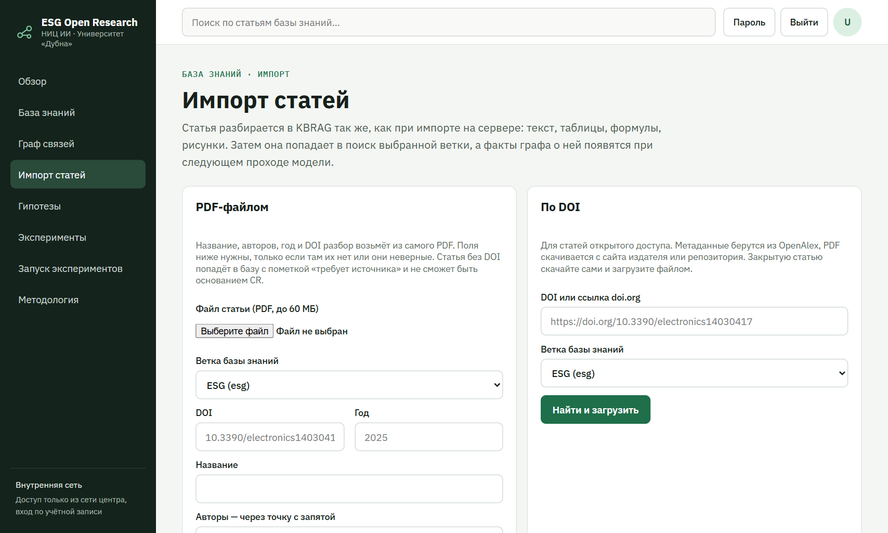

### 4.3. Датасеты

- Список датасетов — на странице «База знаний» (кнопка «Новый датасет» — researcher). У каждого
  датасета своя страница (`DS-01`, `DS-05` …): описание, источник, лицензия, доступ (открытый /
  под NDA), **срезы** и эксперименты на них.

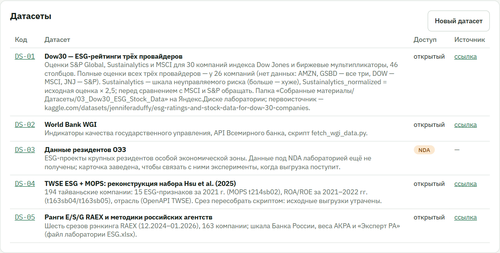
- **Срез** — зафиксированная версия файла данных с хешем sha256; запуск всегда идёт на конкретном
  срезе. Новый срез: «Загрузить срез» (небольшой файл) или «…или зарегистрировать файл с сервера»
  (большой файл, который уже лежит в каталоге датасета на сервере).

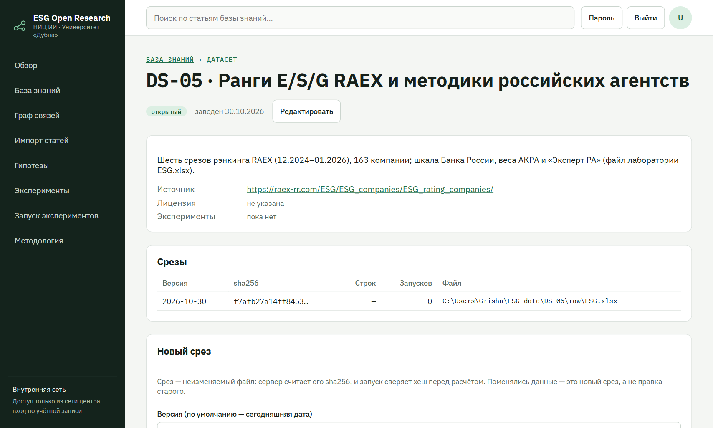
- Файлы под **NDA** видят только допущенные; описание датасета видно всем.
- Общие методы читают **CSV** и **книги Excel (.xlsx)**. У книги лист-таблица — тот, где в первых
  пяти строках есть строка заголовка; столбцы без заголовка (заметки справа) не читаются.
  Буквенные рейтинги (AAA…D, ESG-AA, ESG-BBB+) считаются числами по порядку шкалы; «отозван», «—»,
  «н/д» — пропуск.

### 4.4. Гипотезы

- **Предложить гипотезу** *(researcher)*: формулировка («ESG-раскрытие снижает стоимость долга»),
  обоснование («почему так думаете»), задание методики, к которому она относится.
- Фильтры: «Все», «От Qwen», «Ждут решения», «Приняты», «Проверяются», «Проверены», «Отклонены».
- У гипотезы от Qwen — **опоры**: цитаты из статей базы знаний со ссылками. Проверьте, что цитаты
  действительно говорят то, на что опирается гипотеза.
- **Решение** *(reviewer)*: «Принять к проверке» или отклонить. Принятую гипотезу Qwen снабдит
  предложением эксперимента (через несколько минут).
- **Предложение эксперимента** — на карточке гипотезы: название, метод, срез, параметры, шаги,
  критерий «что подтвердит или опровергнет». Исследователь правит параметры и **одобряет** —
  платформа создаёт эксперимент и ставит запуск в очередь; или **отклоняет** с причиной.
  Если предложение содержит ошибку (столбца нет в срезе и т. п.), это показано над формой.

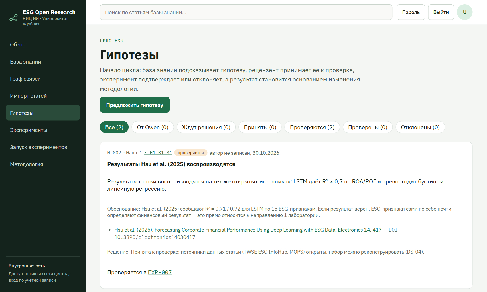

### 4.5. Эксперименты

- **Реестр экспериментов** — все эксперименты со статусом: запланирован, в работе, на проверке,
  завершён — нужна воспроизводимость, и итогом: гипотеза подтверждена / отклонена.

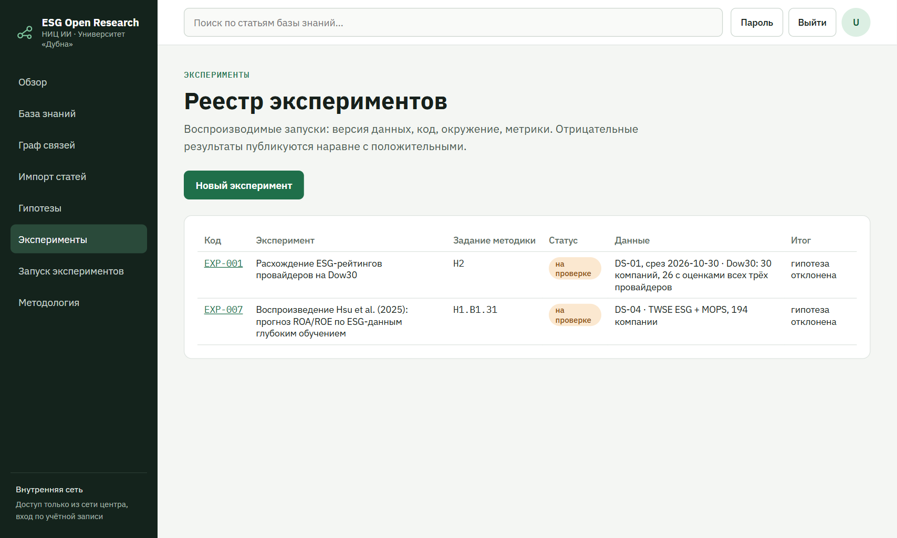
- **Карточка эксперимента**: гипотеза, задание методики, постановка (данные, метод, шаги),
  результаты (ключевые цифры, графики), интерпретация, вывод, влияние на методологию,
  воспроизводимость (коммит runner, окружение, срез, seed), запуски, рецензии, связи с базой
  знаний, **отчёт**.

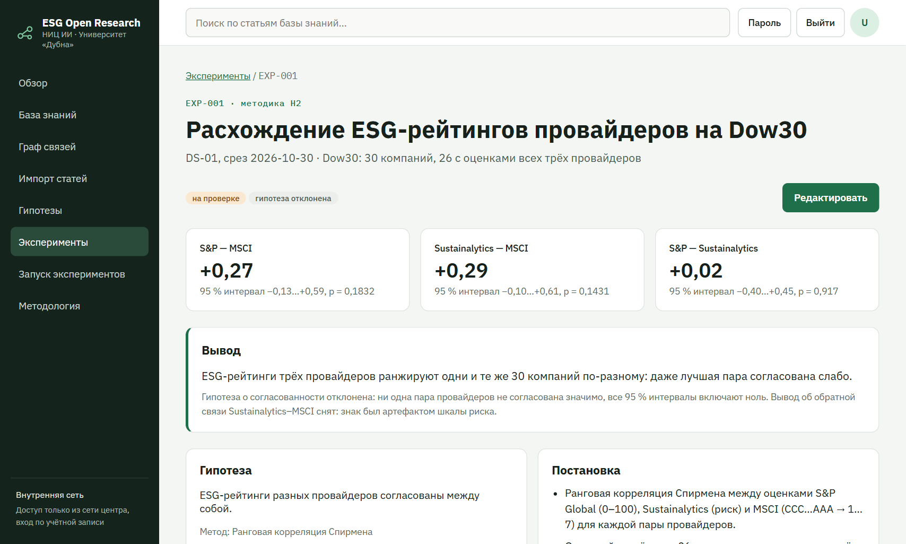
- **Редактировать** *(researcher)* — разделы, ключевые цифры (до 8), графики: «полосы» (сравнение
  величин, до трёх серий) и «диапазоны» (среднее и разброс). Данные графика вставляются таблицей
  через «;», с предпросмотром.
- **Рецензия** *(reviewer)* — вердикт и комментарий внизу карточки.

### 4.6. Запуск экспериментов *(researcher)*

1. **Новый запуск**: метод, эксперимент (в чей реестр пойдёт запуск), срез данных, параметры.
2. Методы библиотеки:
   - **Согласованность показателей** (`rank-agreement`) — ρ Спирмена для каждой пары выбранных
     столбцов, 95 % бутстреп-интервал, перестановочный тест. Для сравнения рейтингов провайдеров,
     оценок. Столбцы «больше — хуже» (шкала риска) отметьте — знак обратится.
   - **Предсказательная проверка** (`predictive-check`, протокол CR-01) — предсказывают ли признаки
     целевой показатель лучше среднего: 30 случайных разбиений, плацебо на перемешанной цели, R² на
     отложенной выборке.
   - **Повторы** опубликованных расчётов (EXP-001, EXP-007) — только на своём датасете.
3. У среза Excel сначала выберите **лист книги** — появятся его столбцы. Для параметров-столбцов
   показываются только подходящие (для чисел — числовые).

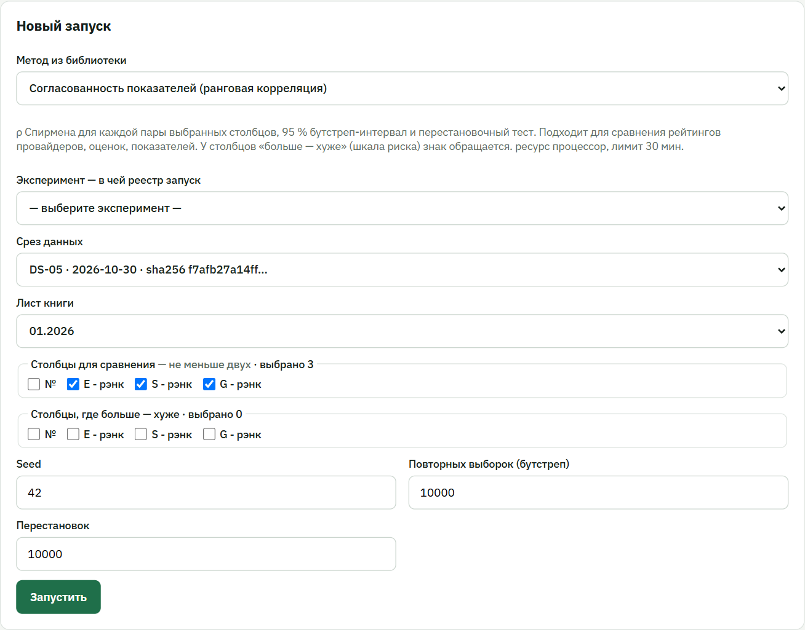
4. «Запустить» → страница запуска: живой **лог** и **метрики**, затем итог и «Параметры и
   воспроизводимость». Расчёт дольше лимита метода останавливается.

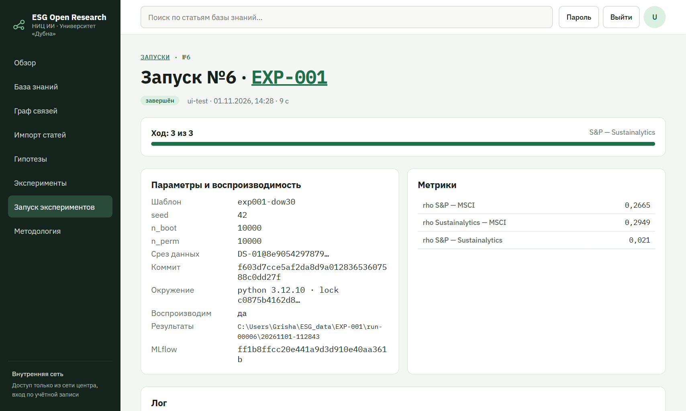
5. **Реестр запусков** — все запуски с отметкой «воспроизводим» (есть коммит без несохранённых
   правок, срез, окружение, seed).

### 4.7. Отчёт об эксперименте

Блок «Отчёт» на карточке эксперимента.

1. Отчёт появляется сам после удачного запуска. Для уже посчитанного эксперимента — «Сформировать
   отчёт», для новой редакции — «Новая версия отчёта». Qwen пишет текст несколько минут.
2. В отчёте: резюме, вердикт по гипотезе, интерпретация, значение для задания методики, предложение
   для методики, ограничения, что дальше. **Цифры, таблицы и графики берутся из расчёта** — модель
   их не придумывает; числа в тексте сверяются с расчётом, лишние показаны предупреждением.
3. **Прочитайте текст**: модель может переоценить вывод, сослаться на статью шире, чем та говорит,
   или записать в «Предложение для методики» план следующего эксперимента. Исправьте —
   «Править текст».
4. «На рецензию» *(researcher)* → рецензент «Одобрить и отправить в базу знаний» или «Отклонить»
   с причиной *(reviewer)*.
5. «Скачать Word» / «Скачать PDF» — в любой момент.
6. Одобренный отчёт попадает в базу знаний (ветка «Отчёты экспериментов»); статус импорта виден
   на карточке. Если в отчёте есть предложение для методики — Qwen готовит черновик CR (ссылка
   появится в блоке отчёта); для любого одобренного отчёта можно нажать «Предложить CR по отчёту».

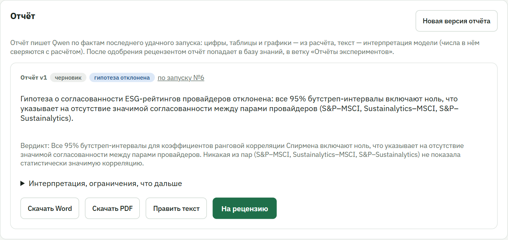

### 4.8. Методология и CR

- **Дерево методики**: направление → вариант → задание; **разделы** (правила) висят на любом узле
  и действуют на всё, что ниже; «Общие разделы» — на всю методику. У узла видны гипотезы,
  эксперименты и открытые CR, которые к нему относятся.

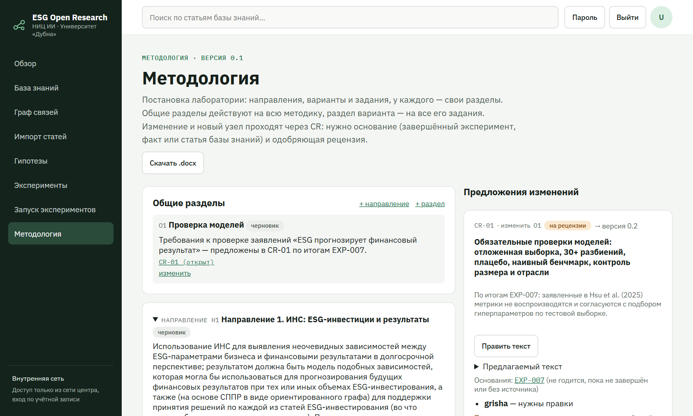
- **Предложить изменение (CR)** *(researcher)*: у узла «Изменить» (новый текст узла) или «Добавить»
  (новый вариант, задание или раздел под ним). Поля: что меняется, зачем (что показали эксперименты
  или статьи), основание — эксперимент (можно добавить позже).
- **Принять CR можно только при двух условиях** (проверяет сервер):
  1. есть хотя бы одно годное **основание** — завершённый эксперимент, проверенный факт базы знаний
     с цитатой или статья с DOI;
  2. есть хотя бы одна **одобряющая рецензия**.
  Пока условия не выполнены, на карточке CR написано, чего не хватает.

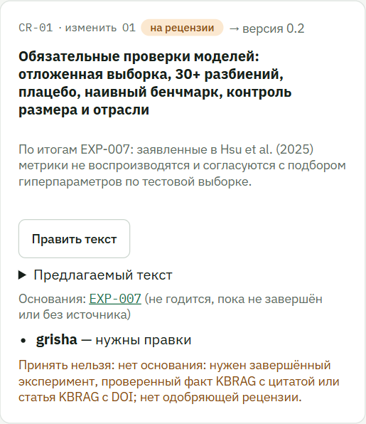
- **Рецензия CR** *(reviewer)*: «Одобрить», «Нужны правки», «Отклонить» с комментарием.
- **Черновик Qwen** отмечен «черновик Qwen по отчёту EXP-… vN» и строкой «Проверить: …» (числа не
  из расчёта, незавершённый эксперимент). Текст CR можно править, **пока нет одобряющей рецензии** —
  одобряют конкретный текст.
- **Принять** *(owner)* — изменение вносится в методику, создаётся новая версия.
- **История версий** — все версии с пояснением, сравнение двух версий по разделам; выгрузка
  текущей методики в Word.

---

## 5. Что делает Qwen и чего от неё ждать

Модель Qwen3-14B работает на видеокарте лаборатории **по требованию**: когда появляется работа,
она запускается (около минуты), выполняет задачи по очереди и выключается после 10 минут простоя.
Поэтому результат приходит не мгновенно — обычно через 1–10 минут; страница обновится сама.

| Когда | Что делает Qwen | Где смотреть |
|---|---|---|
| импорт статьи | достраивает граф фактов, ищет гипотезы для заданий методики | «Граф связей», «Гипотезы» → «От Qwen» |
| новый срез данных | ищет гипотезы, которые можно проверить на этих данных | «Гипотезы» |
| гипотезу приняли | предлагает эксперимент | карточка гипотезы |
| удачный запуск | пишет текст отчёта | карточка эксперимента → «Отчёт» |
| отчёт одобрен | предлагает CR | «Методология» → «Предложения изменений» |

Ограничения модели: она может ошибаться в формулировках, переоценивать слабый результат, повторять
ограничения вместо выводов. Цифры в отчётах всегда из расчёта, но **текст — проверяйте**. Для
некоторых заданий (например, связь ESG с бюджетами регионов и РФ) в корпусе пока нет статей —
по ним Qwen гипотез не находит, пока статьи не загружены.

---

## 6. Для owner

- **Пользователи** → «Новый пользователь»: логин, имя, роль. Платформа покажет **временный пароль
  один раз** — передайте его человеку; при первом входе он задаст свой. «Заблокировать» /
  «Разблокировать» — доступ без удаления истории.
- **Журнал действий** (на странице «Пользователи») — кто, что и когда изменил; содержимое запросов
  (пароли) не пишется.
- **Задачи Qwen** — состояние модели и видеокарты, очередь, история задач; можно поставить задачу
  вручную (проверка модели, достроить граф, поиск гипотез) или снять задачу из очереди.
- **Принятие CR** и новые версии методологии — только owner.

---

## 7. Правила, которые соблюдает платформа

1. У каждой сущности неизменяемый код: `DS-01` — датасет, `EXP-001` — эксперимент, `H-001` —
   гипотеза, `CR-01` — изменение методологии.
2. Методология меняется **только через CR** с основанием и одобряющей рецензией.
3. Каждый запуск фиксирует коммит кода, хеш среза, окружение и seed.
4. Отрицательные результаты публикуются наравне с положительными.
5. Статья без DOI и источника — «требует источника», основанием CR не служит.
6. Данные под NDA: описание видно всем, файлы — только допущенным.

---

## 8. Если что-то не так

| Проблема | Что сделать |
|---|---|
| браузер ругается на сертификат | установите `lab-root-ca.crt` (раздел 1) |
| страница не открывается | вы не во внутренней сети лаборатории — подключитесь к ней |
| «Ошибка 403» / нет кнопки | у вашей роли нет этого действия — обратитесь к owner |
| поиск по базе знаний долго молчит | сократите запрос до 2–4 слов |
| запуск: «в срезе нет столбцов …» | выбран другой лист книги или срез — проверьте лист и столбцы |
| CR не принимается | на карточке CR написано, чего не хватает: основания или одобряющей рецензии |
| Qwen долго не отвечает | модель запускается по требованию — подождите до 10 минут; если дольше, сообщите owner (раздел «Задачи Qwen») |
| ошибка в тексте Qwen | правьте: «Править текст» в отчёте или CR, отклоняйте предложения с причиной |
